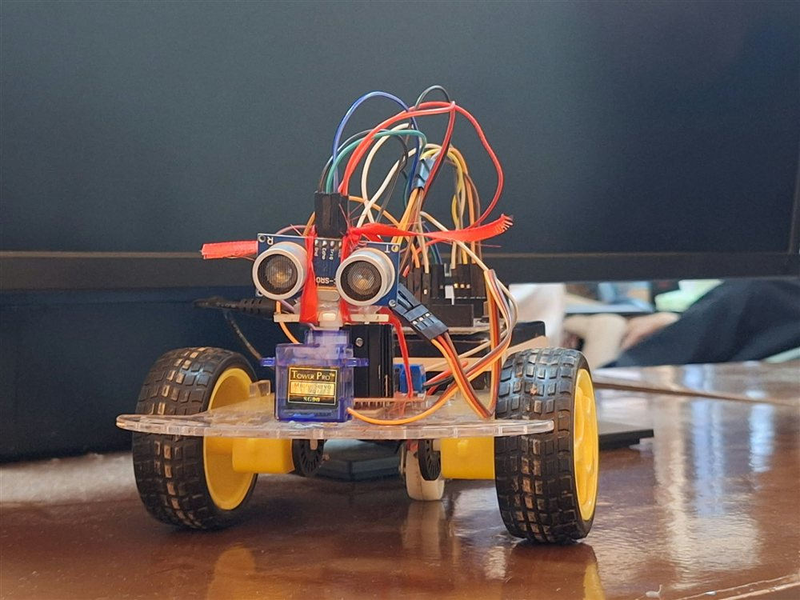

# Robopuff: Line Follower Robot

## Overview

A collaborative Arduino robot controller using five digital line-sensor inputs and differential motor steering.

## Prototype Photograph

## Objectives

- Five sensor inputs
- Forward/left/right motion
- Serial diagnostics

## Technologies Used

Arduino C++, Digital line sensors, PWM motor control.

## Methodology and Implementation

- Five active-low digital inputs on A0–A4 are sampled every 50 ms using millis().
- Center detection, or both near-side sensors, selects forward motion; left/right detection selects a pivot turn.
- Motor direction pins 8–11 and PWM pins 3/5 control two drive sides; serial output reports sensor state and direction.

## Results and Outputs

- Source implements forward motion at PWM 140 and asymmetric turning at PWM 80/100. These are control settings, not measured speed.
- An actual prototype photograph and a local demonstration video are available. No lap time, tracking accuracy or success-rate measurement is documented.

## Limitations

- No explicit stop or recovery branch when all sensors lose the line; the previous motor command persists.
- The supplied photograph shows an ultrasonic/servo-equipped prototype; the five line-sensor array and exact wiring are not visible, so the photo does not verify the firmware hardware configuration.
- Individual responsibilities are not documented in the supplied source. Video participant permissions are unconfirmed.

## Contributors

Collaborative academic project by Tischia Ann Olivares, Michelle Tercero and Rona Mae Quite.

## Source Files

- [Robopuff_LineFollower.ino](Robopuff_LineFollower/Robopuff_LineFollower.ino)
